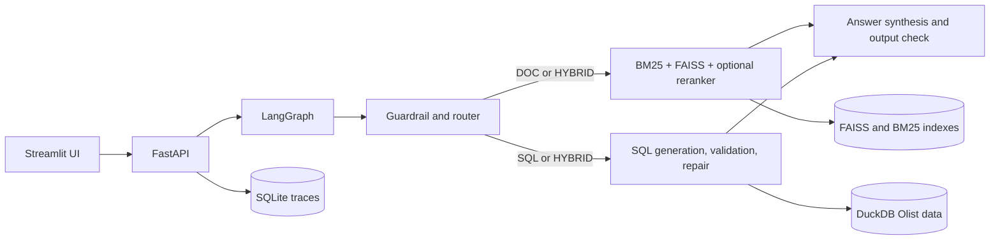

# AskData

AskData is a local-first copilot that answers policy questions from PDFs and Markdown and analytical questions from Olist CSVs using a guarded text-to-SQL pipeline, with citations, retrieval evaluation, and request tracing. It runs with Ollama or Groq and stores its document indexes, DuckDB database, and traces locally.

## Architecture



## Setup

Requires Python 3.11. Install dependencies and prepare local configuration:

```bash
python -m venv .venv
# Activate .venv for your shell, then:
pip install -r requirements.txt
cp .env.example .env
```

The default LLM provider is Groq; set `GROQ_API_KEY` in `.env` for that option. For fully local inference, install [Ollama](https://ollama.com), pull a model such as `llama3.2`, and set `LLM_PROVIDER=ollama` and `LLM_MODEL=llama3.2` in `.env`. Do not commit `.env`.

Put Olist CSV files in `data/raw/`, then load them into DuckDB:

```bash
python scripts/load_olist.py
```

Start the API and UI in separate terminals:

```bash
uvicorn app.api:app --reload --port 8000
streamlit run ui/streamlit_app.py
```

The API exposes `/health`, `/ask`, `/ingest`, `/schema`, and `/traces`. Document indexes are created under `data/index/` on the first ingest or retrieval. The sample policy Markdown files are under `data/docs/`.

## Docker and Hugging Face Spaces

The Dockerfile serves the FastAPI app on port 8000, which can be used directly for a Docker Space. For local API, UI, and Ollama services:

```bash
cp .env.example .env
docker compose up --build -d
docker compose exec ollama ollama pull llama3.2
```

The Streamlit UI is on port 8501. Olist CSVs placed in `data/raw/` can be loaded with `docker compose exec api python scripts/load_olist.py`. The local `data/` directory persists the DuckDB file, indexes, and SQLite traces.

## Evals

`evals/golden_set.json` contains 40 examples: 20 document, 15 SQL, and 5 hybrid. Run:

```bash
python evals/run_evals.py
```

The runner reports Hit@5 and MRR for BM25, vector, hybrid RRF, and hybrid plus cross-encoder reranking; SQL result accuracy against the reference SQL; faithfulness and relevance judgments from `prompts/judge.yaml`; and average latency. It writes detailed results to `evals/results.json`. Full results require the sample docs to be indexed, an available local LLM, and the Olist CSVs for SQL evaluation.

### Evaluation results

No measured results are committed yet. Populate this table from `evals/results.json` after running the evaluation in an environment with the required model and data.

| Retrieval mode | Hit@5 | MRR |
|---|---:|---:|
| BM25 | — | — |
| Vector | — | — |
| Hybrid | — | — |
| Hybrid + rerank | — | — |

SQL execution accuracy, faithfulness, relevance, and mean latency are also recorded in `results.json`.

## Screenshots

- Chat: `docs/screenshots/chat.png` (placeholder)
- Data & Docs: `docs/screenshots/data-docs.png` (placeholder)
- Evals: `docs/screenshots/evals.png` (placeholder)
- Traces: `docs/screenshots/traces.png` (placeholder)

## Design decisions

- **Hybrid retrieval:** BM25 handles exact policy terms and numbers; normalized MiniLM vectors capture semantic matches. Reciprocal rank fusion combines both lists, and a cross-encoder can refine the shortlist. The eval runner also exposes BM25-only, vector-only, and hybrid modes for comparison.
- **SQL safety and repair:** SQL is parsed with sqlglot, restricted to read-only SELECT/UNION statements, and capped at 100 rows for ordinary SELECT queries. Failed execution can enter the existing graph repair loop, which is bounded to two repairs.
- **Guardrails:** The existing graph runs an input guardrail before routing and an output grounding/PII check after synthesis. It refuses unsafe input and replaces output that fails its check with a grounded fallback.

## Tests and lint

```bash
pytest -q
ruff check app scripts evals ui tests
```

The CI workflow runs both commands on pushes and pull requests.
